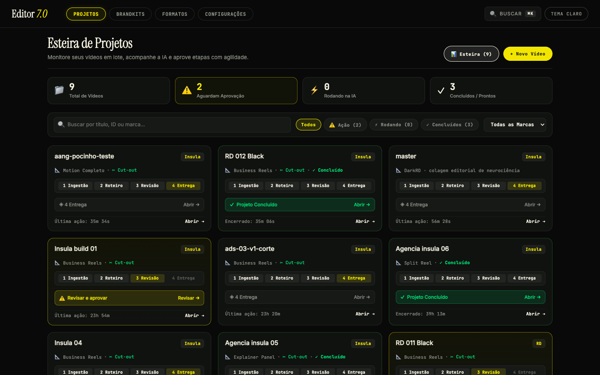
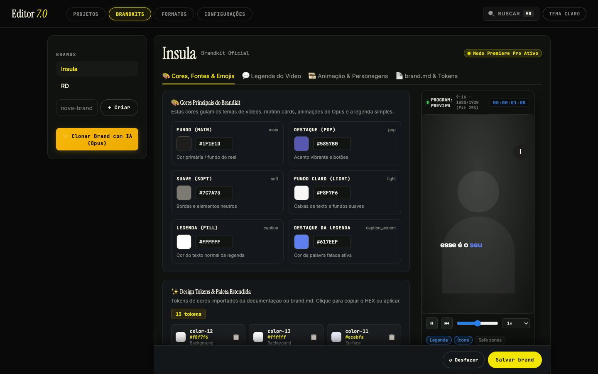
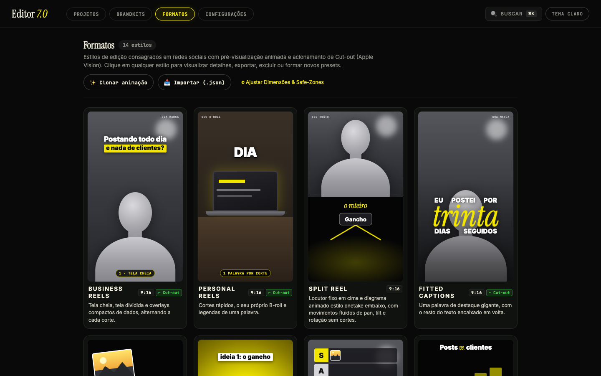
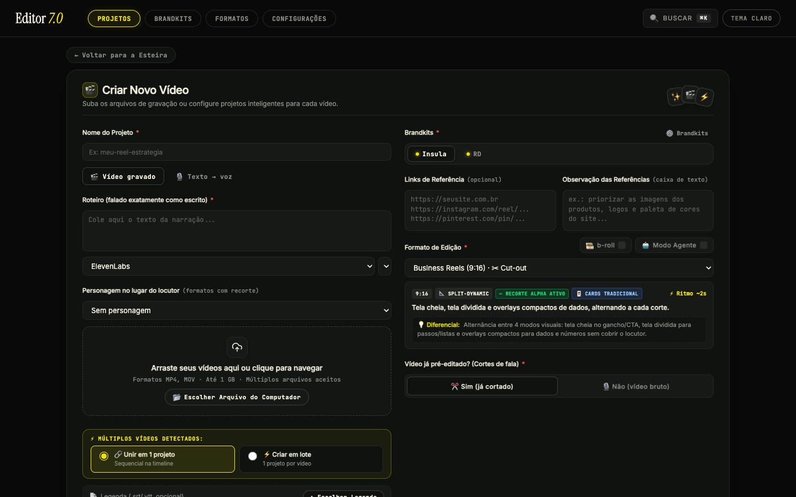
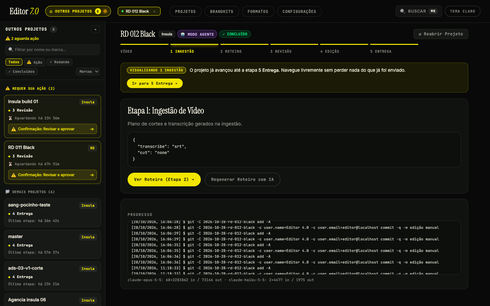
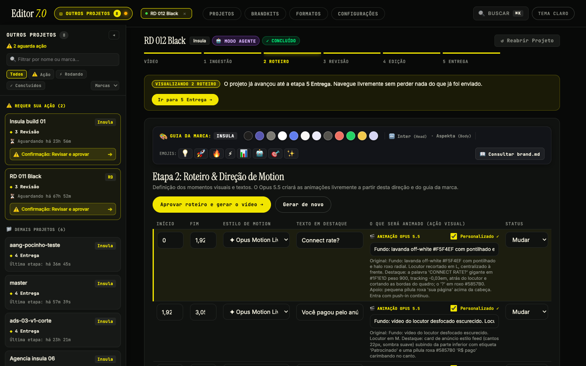
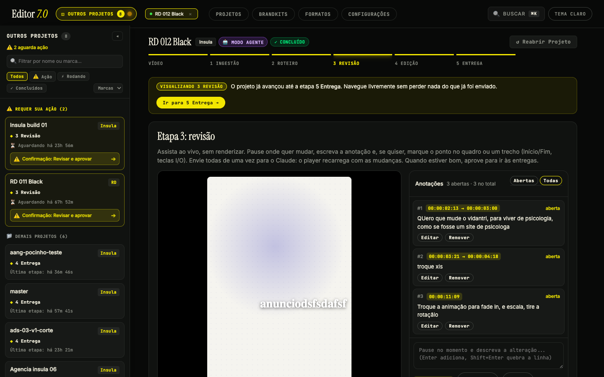
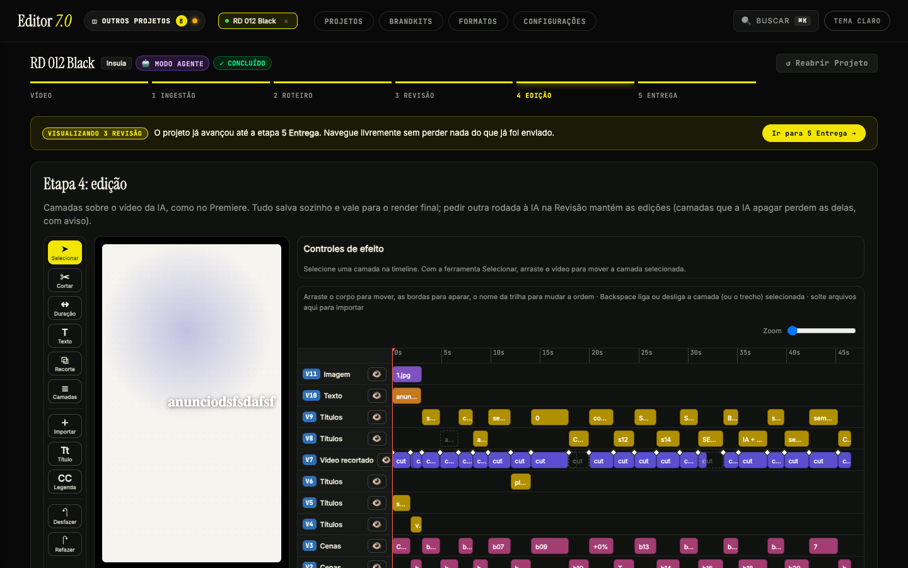
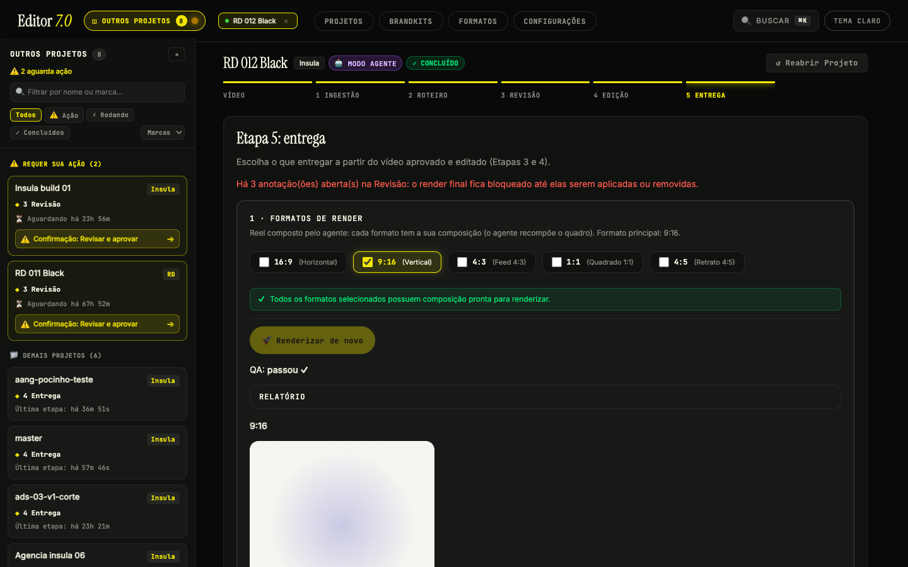

# Guia de uso — Editor 7.0

Você entrega um vídeo bruto (locutor falando) e recebe um reel finalizado na identidade da sua marca. O caminho é sempre o mesmo, em 5 etapas:

**1 Ingestão → 2 Roteiro → 3 Revisão → 4 Edição → 5 Entrega**

A **Esteira** mostra todos os vídeos, em que etapa cada um está e o que espera a sua aprovação.

Antes do primeiro vídeo, monte a **Marca** e escolha um **Formato** (seção "Conceitos").

## Conceitos

- **Marca (Brandkit)**: cores, fontes, ícones, estilo de legenda e regras de voz. Fica em `workspace/brands/<id>/` (`brand.json` + `brand.md`). Crie e edite na aba **Brands**; dá para pedir ao chat da marca para clonar o estilo de uma referência.

- **Formato**: proporção e jeito de montar (reel 9:16, feed 1:1, feed 4:5, YouTube 16:9, motion completo, split etc.). Fica em `workspace/formats/<id>/format.json`. Aba **Formatos**.
- **Projeto**: um vídeo. Fica em `workspace/projects/<id>/` e é um repositório git próprio: cada passo e cada edição manual viram commit, então dá para voltar atrás.

## Passo a passo

### 1. Ingestão

1. Aba **Projetos → Novo Vídeo**. Dê um nome, escolha a marca e o formato. Vídeo gravado ou **Texto → voz** (ElevenLabs). Opcional: **b-roll** e **Modo Agente**.
2. Traga o vídeo bruto: envie o arquivo, escolha um do disco ou cole um link (baixado com yt-dlp).
   - Se já tiver legenda `.srt`/`.vtt`, envie junto: pula o Whisper.
   - Opcional: um **site de referência** (o editor extrai identidade e conteúdo) e um **reel de referência** para imitar o ritmo.
3. O editor normaliza o áudio em -14 LUFS, remove ruído, transcreve com Whisper (idioma em `REEL_LANG`) e rastreia o rosto.

### 2. Roteiro

O Claude (Opus) lê a transcrição, corta pausas e vícios, e propõe o roteiro com os momentos de destaque. Leia, ajuste o texto se quiser e **aprove**.

Ao aprovar:

- Formatos de cards: o modelo cria os cards direto do roteiro.
- Formatos de agente (`composer: "agent"`): o Opus escreve a composição inteira em `compose/`.

### 3. Revisão

O reel toca ao vivo no navegador (nada é renderizado aqui).

- Clique no vídeo, escreva uma **nota** presa àquele instante (e, se quiser, ao ponto exato da tela): "esse card entra tarde", "troque o ícone".
- Junte quantas notas quiser e clique em **Aplicar**. Todas vão ao modelo numa chamada só e o preview é refeito em ~1 s.
- Regra de ouro: quando um card ou animação está na tela, a legenda simples silencia (sem texto sobreposto). Cards ficam de 2,5 s a 4,5 s.
- A Entrega **não libera** enquanto houver notas abertas. Resolva ou apague todas.

### 4. Edição

Timeline em camadas, como no Premiere: selecionar, cortar, duração, texto, recorte, importar, título, legenda, desfazer/refazer. Tudo salva sozinho e vale para o render final. Pedir outra rodada à IA na Revisão mantém as suas edições (camadas que a IA apagar perdem as delas, com aviso).

### 5. Entrega

Tudo o que sai do projeto fica nesta tela:

- **Render final**: gera o master e os desdobramentos (1:1, 4:5, 16:9, respeitando safe-zones e o enquadramento do rosto), com QA automático.
- **Exportar After Effects**: gera um `.jsx`/`.aep` em `<projeto>/after-effects/` com camadas de texto e forma editáveis; o que é complexo (imagens, gradientes, máscaras) vira clipe ProRes 4444.
- **Gerar 3 Embrulhos (IA)**: três ganchos para os primeiros 3,5 s (Curiosidade, Dor, Promessa), para testar qual abertura rende mais.

## Dicas

- **Um passo por vez por projeto**: se um botão estiver travado, há outro passo rodando. Acompanhe o progresso na tela.
- **Desfazer**: entre na pasta do projeto e use `git log` / `git revert`. Cada passo tem um commit.
- **Custo**: Haiku só na triagem, Sonnet no chat de marca, Opus no resto. A tabela está em `server/models.ts` (`MODEL_BY_STEP`); não mude sem revisar o custo.
- **Idioma**: para vídeos em inglês, `REEL_LANG=en ./start.sh`.
- **Fonte faltando**: se a legenda sair numa fonte errada, o arquivo não está em `workspace/brands/<id>/fonts/`.

## Referência rápida

| Quero | Faço |
|---|---|
| Subir o editor | `./start.sh` → http://127.0.0.1:4400 |
| Checar o ambiente | `bash claude-reel-editor/skills/reel-editor/scripts/doctor.sh` |
| Rodar os testes | `cd server && npm test` |
| Ver o que mudou num projeto | `cd workspace/projects/<id> && git log --oneline` |
| Entender a arquitetura | [CLAUDE.md](CLAUDE.md) |

Instalação: [INSTALACAO.md](INSTALACAO.md).
