# HANDOFF: como o Editor 7.0 funciona por dentro

Documento para recomeçar o projeto em outra instância (de Claude ou de pessoa). Descreve o fluxo real lido no código em 30/10/2026, não o fluxo desejado. Leia junto com `CLAUDE.md` (comandos, convenções) e `server/SPEC-formatos-render.md` (histórico do render por cards).

Para começar numa instância nova:

```bash
cd server && npm install && npm run check && npm test
./start.sh            # http://127.0.0.1:4400
```

Antes de recomeçar, note o estado do repositório: `compose/engines/`, `compose/estilos/`, `server/test/models.test.ts` estão sem commit, e `server/pipeline.ts` tem 188 linhas de diff sem commit (diretor/treatment, ILUSTRACAO.md, cópia dos motores para o compose). Uma instância nova que clone o último commit (`472d6cc`) não terá o motor de motion. Faça commit primeiro.

---

## 1. Visão geral: entradas, processos, saídas

```mermaid
flowchart LR
  subgraph IN[Entradas do usuário]
    V[vídeo bruto .mp4/.mov<br/>ou vários clipes]
    S[.srt opcional]
    R[URL de referência<br/>site ou reel]
    IMG[imagens soltas]
    B[marca: brand.json + brand.md<br/>fontes, ícones, personagens]
    F[formato: format.json<br/>+ skill.md opcional]
  end

  subgraph UI[server/ui.html  Vídeo → 1 Ingestão → 2 Roteiro → 3 Revisão → 4 Edição → 5 Entrega]
  end

  subgraph SRV[server/server.ts  rotas → server/pipeline.ts  máquina de estados com lock por projeto]
  end

  subgraph PROC[Processos]
    P1[ingest: ffmpeg + Whisper + corte]
    P2[script: Haiku segmenta, Opus escreve momentos]
    P3a[motionCards: Opus escreve cards → build_reel.py]
    P3b[compose: Opus agente escreve scenes.py → kit.py → index.html]
    P4[layers.json: edição manual sobre o HTML]
    P5[final: hyperframes render + loudnorm + qa.py]
  end

  subgraph OUT[Saídas em workspace/projects/id/  repositório git próprio]
    O1[master.mp4, transcript.json, edl.json]
    O2[script.json]
    O3[edit.json + proj/index.html  ou  compose/scenes.py + compose/index.html]
    O4[final-9-16.mp4 … + QA]
    O5[after-effects/*.aep · embrulhos · preview-motion.mp4]
  end

  IN --> UI --> SRV
  SRV --> P1 --> O1 --> P2 --> O2
  O2 --> P3a --> O3
  O2 --> P3b --> O3
  O3 --> P4 --> P5 --> O4
  O3 --> O5
```



Regras transversais:

- **Um passo por projeto por vez.** `locked(id, step, fn)` grava `workspace/locks/<id>.lock` e emite `step start/done/error` pelo SSE `GET /projects/:id/events`. Enquanto o compose roda (até 45 min), nada mais acontece no projeto.
- **Cada passo e cada edição manual vira um commit** no git do projeto (`commit(id, msg)`).
- **`state.json`** guarda `step` (`created → ingest → script → motion → final`), `composerMode`, `formats`, `style`, e o log de custo por chamada de modelo (`cost[]`).
- **Modelos são fixos por etapa** (`server/models.ts`, `MODEL_BY_STEP`): Haiku para triagem e resumo de QA, Sonnet para cortes, b-roll e embrulhos, Opus para roteiro, cards, análise de referência, ILUSTRACAO.md e o compositor agente. `ask()` força JSON por schema, sem ferramentas; `agent()` dá Read/Write/Edit/Bash restrito e roda dentro de `compose/`.

---

## 2. Fluxo por etapa (gatilho, entradas, processos, saídas)

| Etapa (UI) | Rota | Entradas | Processos | Saídas |
|---|---|---|---|---|
| **Vídeo** (novo) | `POST /projects` → `createProject` | vídeo(s), srt, marca, formato, referência, imagens, `composerMode`, `style`, `brollFill`, ou texto + voz TTS | copia mídia, `writeBrand` (marca + override com `deepMerge`), `git init`, dispara análise de referência (`site_extractor.ts` para site, `yt-dlp` + Opus para reel) | `raw.*`, `brand.json`, `brand.md`, `reference.json`, `ref/`, `ref_site/`, `assets/img/` |
| **1 Ingestão** | `POST /ingest` (encadeia `script` ao terminar) | raw, srt, `brand.pacing` | `clean_audio.py` (DeepFilterNet, -14 LUFS) · `transcribe.py` (Whisper do HyperFrames ou srt) · `spansFromWords`/`tighten.py` (corte de pausas e vícios) · `cut.py` → master · re-transcrição do master · `auto_edit.py` (legendas + punch-ins) · **em segundo plano**: `rvm.py` recorta o locutor (≈5 min por minuto de vídeo) | `voice.wav`, `transcript.json`, `edl.json`, `master.mp4`, `master_transcript.json`, `edit.json`, `cutout.webm`, `cutout.json` |
| **2 Roteiro** | `POST /script`, `PUT /script` (aprovar) | master_transcript, frames amostrados, brand.md, `formatGuide` (format.json), `DIRETOR.md`, site | Haiku `script:segment` (frases limpas) → Opus `script:moments` (lê frames e imagens do site com Read; escreve 1 momento a cada 2-3 s com `visual_action`, `motion_style`, câmera, PLANO-ASSINATURA, `accentWords`) | `script.json` |
| **3 Revisão** (motion) | `POST /motion` → `usesAgent(st)` decide | script.json, brand, format, cutout, site | **Caminho A, cards** (`motionCards`): Opus `motion:cards` escreve `edit.json.cards` (tipo `custom` quase sempre), `validate.ts` valida, até 2 tentativas, `build_reel.py` gera `proj/index.html`. **Caminho B, agente** (`compose`): ver §3. Depois, opcional `brollFill` (Sonnet escolhe beats + Pexels/Pixabay/Commons). | A: `edit.json`, `proj/index.html` · B: `compose/scenes.py`, `compose/index.html`, `compose/review/` |
| Revisão: anotações | `GET/PUT /review`, `POST /review/apply`, `POST /review/build` | `review.json` (nota com t, fim, x/y, texto) | A: Opus `review:apply` devolve só mudanças de cards e correções de legenda, rebuild em ~1 s. B: todas as notas viram **uma** rodada do agente (`compose(id, note)`), que precisa rodar `scenes.py` de novo. `final()` recusa com nota aberta. | `review.json` com `round`, `status`, `reply` |
| **4 Edição** | `GET/PUT /layers`, `POST /media`, `GET /captions` | `layers.json` (textos, cores, camadas adicionadas: texto, imagem, vídeo, áudio, modelo 3D) | `edits.ts`: guarda o HTML da IA como `index.html.ai` e reescreve `index.html` com as edições por id de camada; um novo passe da IA reaplica as edições. Sem modelo. | `layers.json`, `index.html` marcado |
| **5 Entrega** | `POST /final`, `POST /formats`, `POST /compose {format}` (outros aspectos) | formats[], composições por aspecto | B: `syncEdits` + `hyperframes render` em cada `compose[-aspecto]/` + 2× `loudnorm` → `final.mp4`. A: `render.py --final` (REEL_FORMAT). Ambos: `qa.py` (tamanho, duração, LUFS, palavras perdidas); Haiku resume a falha. | `final-9-16.mp4`, `final-16-9.mp4`…, `state.qa` |
| Entrega: After Effects | `POST /ae` | `liveDir/index.html` | `server/ae/make_jsx.mjs` amostra o HTML no Chrome headless, gera clips ProRes 4444 e `build_comp.template.jsx`; `run.jsx` via osascript | `after-effects/*.aep` (gitignored) |
| Entrega: Embrulhos | `POST /embrulhos` | srt, 9 modelos do PDF em `embrulhos/modelos/` | Sonnet escolhe até 3 ângulos e escreve o texto estático; `renderCamadas` compõe PNGs com alfa sobre o vídeo 9:16 | `embrulhos/` |
| Só motion (teste) | `POST /compose {mode:"motion"}` | site, voz, transcript (sem locutor) | mesmo agente com `GUIDE-motion.md`, renderiza | `compose-motion/out.mp4` → `preview-motion.mp4` |
| **Cortes** (lateral, fora do projeto) | `/cortes…` | palestra de ~1 h | Whisper → Sonnet `cortes` escolhe 10 trechos de 1-2 min (duas passagens) → Haiku `cortesSrt` corrige o srt → mp4 + srt por trecho. UI faz polling, sem SSE. | `workspace/cortes/<id>/out/` |
| **Marcas** | `/brands…` | imagem ou YouTube (`cloneBrandWithOpus`), fontes, ícones SVG/PNG, poses de personagem, `brand.md` | Opus clona a marca; `syncBrandMarkdown` mantém brand.md e brand.json coerentes; `testClip` renderiza um clipe de teste | `workspace/brands/<id>/` |
| **Formatos** | `/formats…` | edição por `format.json` (`composer`, `cutout`, `aspectRatio`, `layout`, `camera`, `safeZones`, `editingStyle`, `promptGuide`) | sem modelo | `workspace/formats/<id>/` |
| **Estilos** | `/styles…` | vídeos/imagens de referência (`cloneStyle`), nota (`refineStyle`), `skill.md` do usuário | Opus decupa `beats`, `palette`, `camera` (gramática do kit, limites aplicados por `clampCamera`), `motif`, `guide`, `motionRecipes`, `sfxRules`; `styleGuide` entra no prompt de motion e no `brief.md` quando o projeto tem `styleId`, senão o brief lista os estilos para o diretor | `workspace/styles/<id>/` |
| **Configurações** | `/settings/keys…`, `/update/*` | chaves Pexels, Pixabay, ElevenLabs, Google TTS | `keys.ts` guarda em `~` com modo 0600; `checkUpdate/applyUpdate` fazem `git pull` da raiz | |

Qual caminho a Revisão toma (`usesAgent`, `pipeline.ts:1054`): `composerMode` do projeto manda; senão, `format.composer === "agent"` (hoje só `motion-completo`) ou `format.cutout && referência é site` (business-reels, personal-reels, explainer-panel, fitted-captions, cutout-backdrop com site). Todos os 11 projetos recentes foram pelo caminho B.

---

## 3. O caminho do agente (compose): onde o motor de motion deveria entrar

```mermaid
sequenceDiagram
  participant UI
  participant P as pipeline.ts compose()
  participant SC as composeScaffold()
  participant O1 as Opus ask reference:illustration
  participant O2 as Opus agent compose:treatment
  participant O3 as Opus agent compose
  participant K as kit.py (python3 scenes.py)
  participant HF as hyperframes check/snapshot

  UI->>P: POST /motion (script aprovado)
  P->>SC: montar compose/
  SC->>SC: ensureCutout (espera o RVM se ainda roda)
  SC->>SC: ensureComposeMedia: plate.mp4 (fundo desfocado), voice.m4a
  SC->>SC: copia kit.py, GUIDE.md, DIRETOR.md, engines/*.js, estilos/*.md, motions/ (20 componentes HF), sfx/
  SC->>O1: ILUSTRACAO.md da marca (1 vez por marca, cache em brands/<id>/ilustracao.json)
  SC->>SC: escreve brief.md (marca, formato, momentos do roteiro, srt, assets) e compose.json (W, H, DUR, faceX, cores, safeZone)
  P->>O2: "você é só o diretor": escolher estilo em estilos/README.md, escrever treatment.md (benchmark, 3 estruturas, shot list, câmera, som)
  P-->>P: falha se treatment.md não existir
  P->>O3: "componha o reel": ler brief, DIRETOR, GUIDE, ESTILO/ILUSTRACAO, treatment; escrever scenes.py; loop check + snapshots; não renderizar
  O3->>K: python3 -B scenes.py
  K->>K: scene(n, a, b, bg, cam, back=, front=, world=, sfx=) por cena
  K->>K: canvas(..., engine='swiss') / scene3d(..., engine='diorama') embute engines/<nome>.js só se chamado
  K->>K: lints: câmera de mundo (≥4 moves, 1 signature), enquadramentos, SFX, variedade de tweens, texto gigante em back; layout_check.mjs no Chrome
  K->>K: escreve compositions/*.html, index.html, scenes.json, review/recorte.png
  O3->>HF: check --json, snapshot → snaps/ (lê as folhas de contato com Read)
  P-->>P: falha se index.html não for novo
  P->>UI: step motion done → player <hyperframes-player> toca compose/index.html ao vivo
```

Limites de tempo: `ask()` 20 min por chamada; `agent()` 45 min (`COMPOSE_TIMEOUT_MS`). O treatment e a composição são duas chamadas de agente, cada uma com 45 min.

### O que o compositor é mandado ler antes de escrever uma linha

| Documento | Tamanho |
|---|---|
| `brief.md` (gerado) | ~17 KB |
| `GUIDE.md` | 20 KB |
| `DIRETOR.md` | 7 KB |
| `ILUSTRACAO.md` da marca | ~10 KB |
| `estilos/README.md` + 12 pacotes | ~70 KB |
| `engines/*.js` (8 motores) | ~100 KB de JS minificado em linhas longas |
| `kit.py` (72 helpers) | 110 KB |
| `motions/` (20 componentes HyperFrames) | |
| `assets/transcript.json`, imagens do site, quadros de referência | |

Total na ordem de 250 KB de texto por composição, antes do roteiro de 40 momentos.

---

## 4. Diagnóstico: "o motor de motion não é acionado e trava o processo criativo do Opus"

A sensação está certa, e por dois motivos distintos.

### 4.1 Nenhum reel entregue até hoje passou pelo motor

Medido em `workspace/projects/*/compose/scenes.py` e `state.json` (30/10/2026):

| Projeto | cenas | `canvas(` | `scene3d(` | `engine=` | treatment.md | ILUSTRACAO.md |
|---|---|---|---|---|---|---|
| 2026-10-26-agencia-insula-05 | 21 | 0 | 0 | 0 | não | não |
| 2026-10-26-insula-04 | 14 | 0 | 0 | 0 | não | não |
| 2026-10-28-ads-03-v1-corte | 20 | 0 | 0 | 0 | não | não |
| 2026-10-28-rd-012-black | 22 | 0 | 0 | 0 | não | não |
| 2026-10-29-3-procastinacao | 25 | 0 | 0 | 0 | não | não |
| 2026-10-29-rd-procastinacao-01 | 41 | 0 | 0 | 0 | não | não |
| 2026-10-29-teste-bf-rd (chegou ao final) | 14 | 0 | 0 | 0 | não | não |
| 2026-10-30-novo-motor (05:37) | 0 cenas via `scene(` | 2 | 0 | 0 | não | não |

Nenhuma chamada `compose:treatment` aparece em nenhum `cost[]`. O código que copia `engines/` e `estilos/` para o compose, escreve ILUSTRACAO.md e exige treatment.md é o diff sem commit de `pipeline.ts`; o servidor que rodou essas composições era o processo de 29/10 13:40 (PID 32919, ainda vivo na porta 4499). O servidor novo subiu hoje às 11:09 (PID 6035) e a composição iniciada às 11:13 em `2026-10-30-novo-motor` é a **primeira** com diretor, ILUSTRACAO.md (já gravado em `brands/RD/ILUSTRACAO.md`) e motores disponíveis. Ou seja: o motor nunca foi acionado porque não existia na versão que rodava.

### 4.2 Mesmo com o código novo, o motor é opcional e o agente está sobrecarregado

1. **Motor é opt-in enterrado num kwarg.** O JS de um estilo só entra no HTML se `scenes.py` chamar `canvas(..., engine='x')` ou `scene3d(..., engine='diorama')` (`kit.py:824-830`, `_ENG_USED`). Nenhum lint do `render()` reclama se uma composição inteira não usa motor nem `canvas()`. O system prompt ainda diz que "kit.py e motions/ são uma biblioteca opcional: invente o movimento". A escolha mais barata para o agente é escrever HTML/GSAP à mão, e foi o que fez em 100 % dos casos.
2. **Direção criativa escrita três vezes por três autores.** O roteiro (Opus, etapa 2) já decide câmera, destaque, PLANO-ASSINATURA e `visual_action` por momento. O treatment (Opus, diretor) refaz estrutura, shot list e câmera. O compositor (Opus) recebe os dois e a instrução "redesenhe cada momento livremente". A liberdade declarada contradiz a prescrição acumulada, e o agente gasta o orçamento conciliando documentos em vez de compondo.
3. **Carga de leitura de ~250 KB antes de agir**, com 12 pacotes de estilo quando só um será usado, e 8 motores quando só um ou dois serão chamados. Em 29/10 a primeira tentativa morreu em "claude gave no answer in 20 min" (o limite de 45 min é do código novo).
4. **Cadeia serial com pontos de falha fatal.** Aprovar o roteiro dispara: espera do RVM (≈5 min por minuto de vídeo, se não terminou) → plate/voz → Opus escreve ILUSTRACAO.md → Opus diretor (falha se não gravar treatment.md) → Opus compositor (falha se index.html não for novo). Tudo sob o mesmo lock: a UI mostra "Failed to fetch" e nenhuma outra ação no projeto é possível por até 1 h 30.
5. **Revisão cara.** Cada rodada de notas é uma chamada de agente inteira (45 min) sobre o `scenes.py` todo; não há edição por cena.
6. **Duas verdades sobre as etapas.** `CLAUDE.md` descreve 4 etapas; `ui.html:7001` tem 6 (`Vídeo, 1 Ingestão, 2 Roteiro, 3 Revisão, 4 Edição, 5 Entrega`). Quem recomeça precisa saber que `motion` = Revisão e que Edição não é um step do `state.json`.

### 4.3 Recomendações para a nova instância (ordem de valor)

1. **Tornar o motor obrigatório e verificável.** No `render()` do `kit.py`: erro se o estilo foi escolhido (ESTILO.md ou treatment) e nenhuma cena chamou `canvas/scene3d` com `engine=` desse estilo; aviso se menos de N % das cenas têm ilustração em código. É o único jeito de o agente não escolher o caminho mais barato.
2. **Entregar ao compositor só o pacote escolhido.** Escolha do estilo passa para a criação do projeto ou para o roteiro (Opus já está lá com o site e os frames); `composeScaffold` copia apenas `estilos/<slug>.md` e `engines/<slug>.js` (+ `cinetic.js`, que combina com todos). Corta ~150 KB de leitura.
3. **Fundir treatment no roteiro.** O `script:moments` já produz 80 % do treatment (arco, câmera, assinatura, respiração). Acrescentar ao schema do roteiro `estilo`, `benchmark` e `o que foge do clichê` e gravar `treatment.md` a partir do `script.json` elimina uma chamada de agente de 45 min e um ponto de falha.
4. **Compor por cena, não por reel.** Uma chamada `ask()` com schema por cena (ou por bloco de 5 cenas) devolvendo `back`/`front`/`world` como texto Python, validada por `kit.py` logo em seguida. Falha e revisão passam a custar uma cena, não o reel; o lock dura minutos.
5. **Tirar o RVM do caminho crítico.** Começar o recorte na criação do projeto (hoje começa no fim da ingestão) e, se ainda não acabou quando o roteiro é aprovado, compor com `plate.mp4` e trocar o `cut.webm` depois (o player lê o arquivo, não o conteúdo).
6. **Commitar o motor.** `engines/`, `estilos/`, o diff de `pipeline.ts`, `models.ts`, `kit.py` e `server/test/models.test.ts` precisam de um commit antes de qualquer clone.

---

## 5. Quem é responsável por cada coisa

### Servidor (`server/`)

| Arquivo | Responsabilidade |
|---|---|
| `server.ts` | Tabela de rotas `[método, regex, handler]`, SSE `/events`, arquivos com Range (`/files`, `/live`, `/hf`), guarda de Host/Origin/Content-Type. Sem lógica de negócio. |
| `pipeline.ts` (3009 linhas) | Tudo: estado, lock, commits, as etapas, marcas, formatos, referência, cutout, compose, final, AE, embrulhos. Candidato nº 1 a ser dividido numa instância nova (sugestão: `project.ts`, `brand.ts`, `format.ts`, `compose.ts`, `final.ts`). |
| `models.ts` | `MODEL_BY_STEP`, `EFFORT`, `ask()` (JSON por schema), `agent()` (Opus com ferramentas em `compose/`), timeouts, mensagem de cota. É a política de custo. |
| `lib.ts` | Funções puras: spans de palavras, remap de tempos, `deepMerge`, lista de aspectos, `safeId`. |
| `validate.ts` | Fronteira de confiança do `edit.json`: tipos de card, card `custom`, ícones, fontes, estilo de legenda, presets de animação. |
| `edits.ts` | Etapa Edição: `layers.json` aplicado sobre `index.html` da IA (`index.html.ai`), por id de camada. |
| `site_extractor.ts` | Captura desktop/mobile, imagens, textos, paleta de um site de referência → `reference.json`, `ref/`, `ref_site/`, `assets/img/`. |
| `cortes.ts` | Produto lateral Cortes (palestra → 10 trechos). |
| `embrulhos.ts` | 9 molduras do PDF, seleção por ângulo (Sonnet), composição PNG + vídeo 9:16. |
| `broll.ts`, `keys.ts`, `voice.ts` | Busca de b-roll (Pexels, Pixabay, Commons), chaves em `~`, TTS (ElevenLabs, Google). |
| `layout_check.mjs` | Mede no Chrome headless se o texto respeita o locutor (GUIDE §2-§8); `kit.render()` o chama; escreve `review/recorte.png`. |
| `ae/make_jsx.mjs`, `ae/build_comp.template.jsx` | Exportação After Effects. `pack_aep.mjs` está morto. |
| `test/` | 16 arquivos `node --test` + 3 Python (`test_kit_lint.py` testa os lints do kit). |

### Interface (`server/ui.html`, 11 050 linhas, sem build)

| Trecho | Tela |
|---|---|
| `renderEsteiraGrid` (~5864) | **Esteira**: grade de projetos (rodando, aguardando confirmação, concluídos), via `GET /projects/overview`. |
| `renderNewVideoForm` (~6091) | **Novo vídeo**: upload (`/upload`, `/pick-file`, `/probe`), marca, formato (`switch` por id de formato), estilo (`GET /styles`), referência, `composerMode`, `brollFill`, voz. |
| `STEPS` (7001) + `renderStepsBar` (7111) + `render()` (7259) | **Barra de etapas e tela do projeto**: Vídeo, 1 Ingestão, 2 Roteiro, 3 Revisão, 4 Edição, 5 Entrega; assina o SSE; `renderNotes` (8135) é o painel de anotações sobre o `<hyperframes-player>`. |
| `renderPremiereBrandEditor` (3770), `renderIdentityTab` (5396), `openCloneBrandModal` (4705), `openBrandMdModal` (5021), `renderBrandGuideBar` (5089), `renderPremiereFontPanel` (4682) | **Marcas**: editor de brand.json, brand.md, fontes, clonagem por imagem/YouTube. |
| `openFormatModal` (9939), `openCloneModal` (9442), `renderFiles`/`renderUrls` (9712/9778), `renderStyleAnim` (9133) | **Formatos**: edição do format.json, clone por vídeos/imagens/URLs, aba Skill, prévia de animação. |
| `showToast`, `renderHeaderTabs`, `openCmdPalette`, `renderSidebarProjects` (10350-10622) | Chrome da aplicação: toasts, abas recentes, paleta de comandos, barra lateral. |
| Cortes e Configurações | Telas próprias ligadas a `/cortes…` e `/settings/keys…`. |

### Motor de mídia (`claude-reel-editor/skills/reel-editor/`)

| Arquivo | Responsabilidade |
|---|---|
| `SKILL.md`, `references/` | O mesmo fluxo descrito para uso manual como skill do Claude Code (o servidor só usa a pasta para achar scripts). |
| `scripts/transcribe.py` | Whisper local via HyperFrames, ou srt/vtt → `transcript.json` com tempo por palavra. |
| `scripts/clean_audio.py` | Limpeza da voz, -14 LUFS. |
| `scripts/tighten.py`, `pacing.py` | Remove vícios e encurta pausas conforme `brand.pacing`. |
| `scripts/cut.py` | Aplica `edl.json` → `master.mp4` Full HD. |
| `scripts/auto_edit.py` | Rascunho de `edit.json` (legendas e punch-ins). |
| `scripts/rvm.py`, `nose.swift` | Recorte do locutor com alfa (RVM ONNX); rastro do nariz (Vision) para enquadrar. |
| `scripts/build_reel.py` | Caminho A: `edit.json` + `brand.json` → projeto HyperFrames (`proj/`). Sem testes. |
| `scripts/render.py`, `qa.py`, `deliver.py` | Render do caminho A, QA (tamanho, duração, LUFS, palavras perdidas), cópia de entrega. |
| `scripts/make_sfx.py` | Banco de SFX (earshot) → `compose/sfx/*.wav` + `manifest.json`. |
| `scripts/setup_engine.py`, `doctor.py`, `screenshot.py`, `review_sync.py`, `timings.py` | Instalação do player HF e GSAP; checagem da máquina; captura de site; ponte com a página de revisão antiga. |
| `compose/kit.py` (1317 linhas) | **O motor do caminho B**: `scene()`, câmera de mundo, 60+ helpers tipográficos e de UI, `canvas()`/`scene3d()`, `engine()`, lints, `render()` → `compositions/*.html` + `index.html` + `scenes.json`. |
| `compose/engines/*.js` | 8 motores por estilo (silkscreen SK, briefing BB, swiss SW, deco AD, sketch SB, launch LA, cinetic CN, diorama DI), funções puras de `t`, demos em `engines/demos/`. |
| `compose/estilos/*.md` | 12 pacotes de estilo (8 com motor, 4 só receita); `README.md` é o índice que o diretor consulta. |
| `compose/GUIDE.md`, `GUIDE-motion.md`, `DIRETOR.md` | Regras técnicas do compositor (camadas, enquadramentos, fluidez, código), variante sem locutor, e o método de direção (benchmark, estrutura, câmera, treatment). |
| `compose/sfx/` | SFX renderizados, copiados para `compose/assets/sfx/`. |
| `engine/hf/` | HyperFrames 0.8.217 (player e runtime servidos em `/hf/*`), 20 composições de catálogo copiadas para `compose/motions/`. `engine/gsap.min.js`. |
| `anim-presets.json` | Presets de animação de legenda do caminho A. |

### Fora do servidor

`tools/index_refs.mjs` (indexador de referências) e `tools/vision_cutout.swift` (recorte por Vision, substituído pelo RVM) não são chamados.

### Dados (`workspace/`)

`brands/<id>/` (brand.json, brand.md, ILUSTRACAO.md + ilustracao.json, fonts/, icons/, characters/) · `formats/<id>/` (format.json) · `styles/<id>/` (style.json, skill.md, refs/) · `projects/<id>/` (repositório git; ver §2) · `cortes/<id>/` · `locks/` · `uploads/` · `tests/`.

---

## 6. Estado em 30/10/2026 11:15

- Dois servidores rodando: PID 6035 na porta 4400 (subiu 11:09, código novo) e PID 32919 na porta 4499 (29/10 13:40, código velho, sem motor). Uma UI aberta em `:4499` compõe sem motor. Mantenha só o `:4400`.
- Projeto `2026-10-30-novo-motor`: lock `motion` desde 11:13:44; ILUSTRACAO.md da marca RD gravado às 11:15:24; o diretor começou o treatment às 11:15:25. É o primeiro teste real do motor. Se falhar em "O diretor não escreveu treatment.md" ou por timeout, o diagnóstico da §4.2 se confirma na prática.
- Testes: `cd server && npm run check && npm test` não foram rodados nesta análise.
