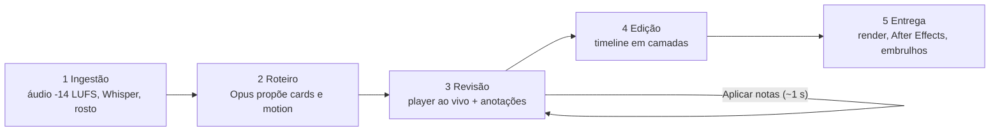

# Editor 7.0 — Estação de Edição Criativa de Vídeo com IA

O **Editor 7.0** é o resultado da convergência e maturação do ecossistema Connect-hub, integrando o que há de melhor em cada versão histórica:
- **Interpretação de referências e ritmo dinâmico** do Editor 1.0;
- **Motor After Effects (.jsx e .aep)** híbrido nativo do Editor 3.0;
- **Layout de painéis estilo Essential Graphics** do Editor 4.0;
- **Desacoplamento total entre Formatos e Brandkits**, com telas dedicadas e seleção por referência na criação do projeto;
- **Regra de Ouro da Dupla Verificação:** quando um card gráfico ou animação está na tela, a legenda simples silencia automaticamente (zero sobreposição de texto);
- **Duração adaptativa de cards:** permanência de 2.5s a 4.5s conforme o fluxo da fala, mantendo o ritmo de tela ágil a cada 1.5s;
- **Recorte sob demanda da pessoa** via Apple Vision (`vision_cutout.swift`);
- **Motor de Embrulhos (Hooks):** geração de 3 ângulos criativos (Curiosidade, Dor, Promessa) para os primeiros 3.5s do vídeo.

---

## Como funciona


Você entrega um vídeo bruto de locutor e o editor devolve um reel pronto na identidade da marca, em 5 etapas. Cada projeto é um repositório git próprio, então cada passo e cada edição ficam registrados e reversíveis.



| Etapa | O que acontece | Tela |
|---|---|---|
| Novo vídeo | Escolha marca, formato e referências |  |
| 1 Ingestão | Limpa o áudio, transcreve e rastreia o rosto |  |
| 2 Roteiro | O Claude Opus escreve o roteiro e a direção de motion; você aprova |  |
| 3 Revisão | O reel toca ao vivo; anotações presas a um instante, aplicadas em lote |  |
| 4 Edição | Timeline em camadas com ferramentas manuais |  |
| 5 Entrega | Render nos formatos, QA, After Effects e 3 ganchos |  |

**Marcas e formatos** são dados separados: a marca define cores, fontes e legenda; o formato define proporção e jeito de montar. Combine qualquer marca com qualquer formato.

| Brandkits | Formatos |
|---|---|
|  |  |

Detalhes de uso em [GUIA.md](GUIA.md); arquitetura em [CLAUDE.md](CLAUDE.md).

---

## Como Rodar

> Primeira vez? Siga a [Instalação](INSTALACAO.md) e depois o [Guia de uso](GUIA.md).

```bash
cd "/Volumes/Extreme SSD/Connect-hub/Editor 7.0"
./start.sh
```

Acesse no navegador: **`http://localhost:4400`**

---

## Estrutura de Pastas

```
Editor 7.0/
├── server/
│   ├── server.ts         # Servidor HTTP local + Eventos SSE
│   ├── pipeline.ts       # Máquina de estados (Passos 1 a 6)
│   ├── ui.html           # Interface SPA com Top Navbar (Projetos, Brands, Formatos)
│   └── ae/               # Motor do After Effects (make_jsx.mjs, build_comp.template.jsx, pack_aep.mjs)
├── tools/
│   ├── index_refs.mjs    # Indexador de referências (cortes FFmpeg + folha 6x2)
│   └── vision_cutout.swift # Recorte de pessoa nativo do macOS (Apple Vision RGBA)
├── claude-reel-editor/   # Scripts de áudio (-14 LUFS), Whisper, nose.swift e build_reel.py
└── workspace/
    ├── formats/          # Formatos desacoplados (reel-9-16, feed-1-1, feed-portrait-4-5, youtube-16-9)
    ├── brands/           # Brandkits (cores, fontes, ícones, regras de legenda)
    └── projects/         # Projetos de vídeo do usuário
```

---

## O Workflow de Produção (Passos 1 a 5)

1. **Ingestão e Decupagem:** Escolha de arquivo nativo (`POST /pick-file`), normalização de áudio em -14 LUFS (`clean_audio.sh`), transcrição Whisper e tracking facial (`nose.swift`).
2. **Roteiro e Sugestões:** O Claude Opus identifica picos de interesse e sugere cards animados com liberdade criativa.
   - *Sub-passo 2.1:* O texto que não vira card vira legenda contínua; quando o card entra, a legenda simples silencia automaticamente.
3. **Timeline e Ajustes em Lote:** Playhead com agulha arrastável, cards com alças para estender duração (2.5s a 4.5s), duplo clique para destacar palavras e botão "Enviar N alterações" sem bloquear o servidor.
4. **Aprovação do Master e Desdobramento:** Geração automática para 1:1, 4:5 e 16:9 respeitando safe-zones e enquadramento de cabeça/rosto.
5. **Entrega, Embrulhos e After Effects:**
   - Botão **Gerar 3 Embrulhos (IA):** variações de gancho (Curiosidade, Dor, Promessa);
   - Botão **Exportar After Effects (.jsx):** projeto ExtendScript completo com camadas nativas editáveis.
