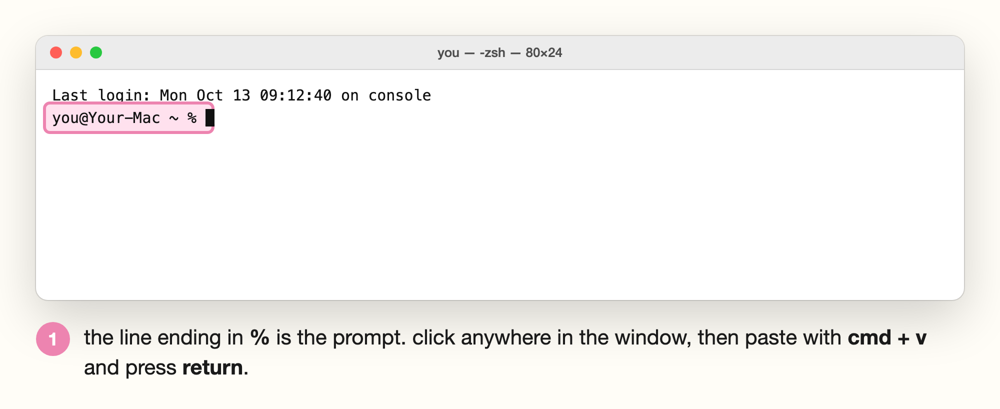
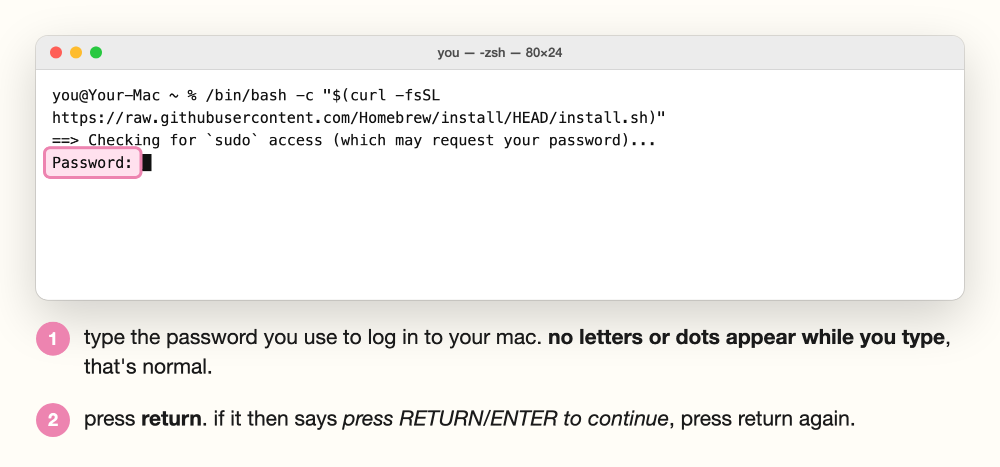
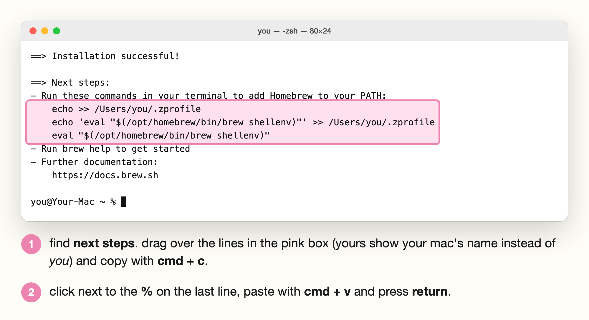
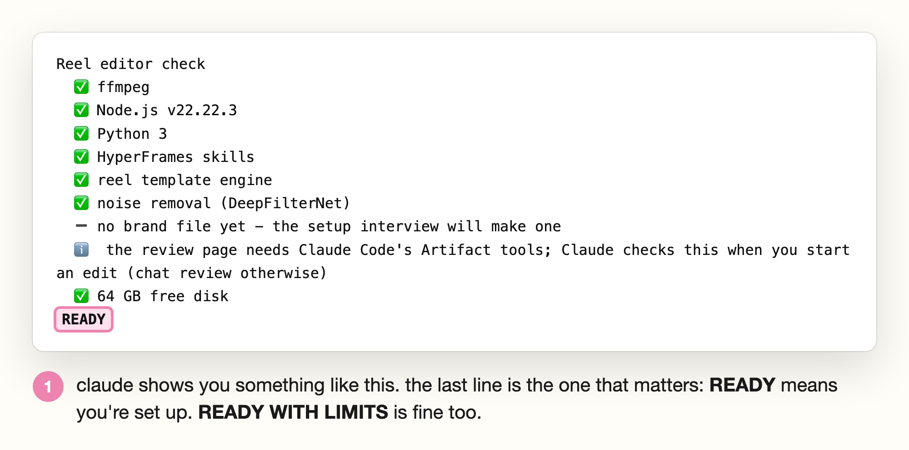

# setup guide (for total beginners)

if you've never opened terminal before, this is for you. setup takes about 20 minutes and you only do it once. after that, editing a reel is dragging the video in and answering a couple of questions.

you'll copy and paste a few commands along the way. you don't need to understand them, i promise. every command on this page has a copy button in its top right corner, so you never have to type one out.

---

## start here

**you'll need:**

- a mac (that's what i've tested on)
- a paid claude plan (pro or higher)
- about 10 GB of free space

**open this guide on your mac,** not your phone. you'll be copying commands from here into your mac, so it's much easier if they're on the same screen.

---

## step 1: get claude

1. go to [claude.com/download](https://claude.com/download), download the claude desktop app, open it and sign in.
2. click the **</>** icon at the top of the app (next to the speech bubbles). that's the **code** tab, it turns grey when it's on. this is claude code, the version of claude that can work with files on your computer.


leave claude open, you'll come back to it in step 5.

## step 2: open terminal

terminal is an app that's already on your mac. it's where you type commands.

1. press `cmd + space` to open spotlight search.
2. type `terminal` and press **return**.

a white (or black) window opens with a line ending in `%`. that's the prompt, and it means terminal is ready for a command.



## step 3: install homebrew

homebrew is a free app installer for mac. the video tools come from it.

1. click the copy button on the command below.
2. click inside the terminal window, press `cmd + v` to paste, then press **return**.

```bash
/bin/bash -c "$(curl -fsSL https://raw.githubusercontent.com/Homebrew/install/HEAD/install.sh)"
```

3. it asks for your **password**. this is the password you use to log in to your mac. type it and press **return**. you won't see any letters or dots while you type, that's normal, it's still working.



4. it may ask you to **press return** to continue. press return.
5. now wait. it can take 5 to 10 minutes. it's finished when you see **installation successful** and the `%` prompt comes back on the last line.

## step 4: finish homebrew's setup

take this step slowly. if you skip it, the video tools won't install.

at the end of what homebrew printed, scroll up a little until you find **next steps**. under it are two or three lines that start with `echo` or `eval`. they have your mac's name in them, so they're slightly different for everyone, which is why you copy them from your own terminal and not from here.



1. click and drag over those lines (the ones in the pink box above) to select them.
2. press `cmd + c` to copy.
3. click at the bottom of the terminal window, press `cmd + v` to paste, then press **return**.

nothing much prints, that's fine. when the `%` prompt is back, check it worked by pasting this and pressing **return**:

```bash
brew --version
```

if it prints `Homebrew` and a version number, you're good. if it says `command not found: brew`, close terminal, open it again, and run `brew --version` once more.

## step 5: install the video tools

these are the free tools claude uses to cut video and clean up audio. still in terminal, paste this and press **return**:

```bash
brew install ffmpeg node
```

this one takes a few minutes and prints a lot. go make a coffee. it's done when the `%` prompt comes back on the last line.

you can close terminal now. you won't need it again for normal editing.

## step 6: install the reel editor (back in claude)

go back to the claude app, on the **code** tab. paste this into the message box and press **return**:

```
install the reel editor from github.com/nicolapocock/claude-reel-editor and the hyperframes skills it needs (npx skills add heygen-com/hyperframes), then run its doctor check and tell me if anything is missing
```

claude does the rest. **claude may ask permission to install the tools.** check that what it's asking about relates to this setup (the reel editor, hyperframes, ffmpeg, node) before you approve it.

at the end it runs a check and shows you a list with ticks. you're done when the last line says **READY**.



**READY WITH LIMITS** is fine too. it means something optional is missing, like the noise remover or capcut, and you can still edit. the ⚠️ lines tell you what you'd gain by adding it.

if any line has a ❌, copy the whole message, paste it back to claude and say "fix this".

## step 7: your first reel

1. film yourself talking to camera on your phone. under 2 minutes is easiest for your first one.
2. airdrop or copy the video to your mac.
3. in claude code, type **edit this into a reel** and drag the video file into the message box. press **return**.
4. **first time only:** claude asks you about your brand, one question at a time (colours, fonts, caption style, sounds, and how tight you want the pacing. natural is the default and keeps your normal pauses). the most useful thing you can give it is a reel you wish you'd made, so have a link ready. this part takes about 5 minutes.
5. claude sends you a link to your **reel review** page. it's private, on your claude.ai account. open it and:
   - press **play rough cut** to watch the edit with your changes as you make them. use −5s / +5s or drag the bar to move around.
   - **cuts:** tap a word to cut it, or tap a crossed-out word to bring it back. grey dotted words are "um"s and ⏸ chips are pauses it removed, tap one to keep it.
   - **graphics:** keep, change (say what) or drop each one. the little picture shows roughly where it sits.
   - **captions:** tap a word to make it a highlight word, tap **edit** to fix spelling, **merge** to join two.
   - **sound & colour:** listen to your voice before and after, and switch off any sound effect you don't like.

   everything saves as you go, and **undo** is there if you change your mind.

   **no review page link?** if your claude code doesn't have artifacts yet, claude does the review with you in chat instead. it shows your transcript as numbered lines with the cuts it suggests, then the graphics it plans. reply with the line numbers to keep or cut and what to change, and say yes when you're happy. claude then builds the draft and tells you where the video is on your mac. watch it, and tell claude in chat what to change, with the time it happens (for example "at 0:12 the caption covers my face"). that replaces steps 5 to 7.
6. **make the preview. this takes two clicks in two places:**
   1. on the review page, click **build preview**.
   2. go back to claude code and type **build preview**, then press **return**.

   about 4 minutes later the draft shows up in the **preview** tab of the review page.
7. watch it. if something's off, pause there, describe it, and press **add note at current time**. tell claude when you're done and it fixes those spots.
8. when you're happy, type **final** in claude code. your full-quality reel (at the resolution you picked in setup) lands in **movies → reels** on your mac. airdrop it to your phone and post.

from your second reel on, it's just steps 7.1 to 7.3, then 7.5 to 7.8. your brand is saved, so every edit already looks like you.

## want the capcut version too? (optional)

capcut gives you an editable version where every caption and sound effect is its own layer, so you can change those yourself after. the graphics, screenshots and hook title come baked into the video, so change those on the review page before you build.

**check this first:** it doesn't work in the us (capcut's connector isn't available there yet) or india (the capcut app isn't available). everywhere else it usually works. if you're in either place, skip this, you'll still get the full finished reel.

1. make a free account at [capcut.com](https://www.capcut.com).
2. paste this into claude code and press **return**:

   ```
   set up the optional capcut route for the reel editor, following references/capcut.md in the skill
   ```

   claude adds capcut's connector for you. if it asks permission, check the request is about capcut before you approve it.

3. log in to capcut once. open terminal, type `claude` and press **return**. then type `/mcp` and press **return**, pick `capcut_creation`, and sign in with your capcut account when the browser opens. after that, every reel comes with a capcut link as well.

## want to build your own?

if you'd like to understand how this works or build your own version, read [build it yourself](BUILD-IT-YOURSELF.md). it has the prompts i used, in order.

## if something goes wrong

| what you see | what to do |
|---|---|
| `command not found: brew` | close terminal and open it again. still broken? redo step 4, copying the next steps lines from your own terminal |
| `command not found: ffmpeg` or `node` | run `brew install ffmpeg node` again |
| terminal seems frozen after the password | it's working, the letters are hidden on purpose. type your password and press return |
| the check says something is ❌ | paste the whole message into claude code and say "fix this" |
| capcut won't connect | if you're in the us or india, that's capcut's region block and there's nothing to fix. anywhere else, ask claude to log you in to capcut again |
| the review page won't load | open it from the link claude gave you, signed in to your claude.ai account |
| the rough cut won't play | press play rough cut once more (browsers sometimes block the first play). if it still won't, reload the page |
| the edit looks off-brand | tell claude what's wrong ("captions are too small", "never use that font"). it adds it to your brand rules so it doesn't happen again |
| your mac is slow or out of space | you need about 10 GB free. 4k needs 35+ GB, so stick to 1080p if your mac is older |

## changing your style later

your brand lives in two files in a folder called **reels** in your home folder. you never have to open them. tell claude what to change ("make my captions one word at a time", "use pink for highlight words") and it updates them.

stuck anywhere? dm me [@getgitgirl](https://instagram.com/getgitgirl), i'm happy to help.
